# ANVAYA Mobile Screen Inventory & Architecture (Expo SDK 53)

> **Document Status**: Complete Baseline Inventory (Step 0)  
> **Target Framework**: React Native 0.79 / Expo SDK 53, Expo Router v5, TypeScript Strict  
> **Design Philosophy**: Deep Teal / Pine Green palette (#0D4A47), 44pt tap targets, safe areas, i18n English + Telugu (machine-drafted), zero hardcoded strings.

---

## 1. Role-Based Navigation Architecture (Max 5 Tabs Per Role)

In accordance with strict navigation guidelines, each authenticated role is limited to a maximum of **5 bottom tabs**. Secondary configuration, preferences, support, and administrative sub-screens are nested inside the dedicated **"More"** tab or pushed as sub-routes via stack navigation.

### Role Tab Mapping

| Role | Tab 1 | Tab 2 | Tab 3 | Tab 4 | Tab 5 |
| :--- | :--- | :--- | :--- | :--- | :--- |
| **Doctor** | 🏠 Home | 👥 Patients | 📋 Prescriptions | 🩺 Appointments | ⋯ More |
| **Shop** | 🏠 Home | 📷 Dispense | 💳 Billing | 📖 Customers (Khata) | ⋯ More |
| **Patient** | 🏠 Home | 📱 Wallet | 📅 Appointments | 📁 Records | ⋯ More |

*The **"More"** tab for each role provides unified access to: Profile & Edit Profile, Settings (Language En/Te, Notifications, Multi-Device Logout), Notification Inbox, Help & FAQs, Legal (Draft Terms & Privacy Policy), Account Deletion / Data Export, and Sign Out.*

---

## 2. Mermaid Navigation Map

```mermaid
flowchart TD
  subgraph Root ["App Entry & Auth Flow"]
    SPLASH["Splash / Session Restore"] --> AUTH_CHECK{"Authenticated?"}
    AUTH_CHECK -- No --> WELCOME["A1: Welcome / Onboarding"]
    WELCOME --> LOGIN["A: Login Screen"]
    LOGIN --> REGISTER["A: Registration (Doctor/Shop/Patient)"]
    LOGIN --> FORGOT_PW["A2: Forgot Password (OTP Verification)"]
    AUTH_CHECK -- Yes --> STATUS_CHECK{"Account Status"}
    STATUS_CHECK -- PENDING --> PENDING_VERIF["A6: Pending Verification"]
    STATUS_CHECK -- REJECTED --> REJECTED_VERIF["A6: Rejected (Correction/Resubmit)"]
    STATUS_CHECK -- SUSPENDED --> SUSPENDED_ACC["A6: Suspended Account Notice"]
    STATUS_CHECK -- ACTIVE --> ROLE_DISPATCH{"User Role"}
  end

  subgraph PatientGroup ["Patient Flow (Max 5 Tabs)"]
    ROLE_DISPATCH -- PATIENT --> P_TABS["(patient) Bottom Tabs"]
    P_TABS --> P_HOME["B1: Home Dashboard"]
    P_TABS --> P_WALLET["B: Wallet & Health Card"]
    P_TABS --> P_APPT["B3: Appointments List"]
    P_TABS --> P_RECORDS["B7: Medical Records"]
    P_TABS --> P_MORE["A4: More Hub"]

    P_HOME --> P_FIND_DOC["B2: Find Doctor & Book"]
    P_HOME --> P_REFILLS["B6: Refill Reminders"]
    P_HOME --> P_BILLS["B5: My Bills & Invoices"]
    P_APPT --> P_APPT_DETAIL["B3: Appointment Detail"]
    P_RECORDS --> P_RECORD_DETAIL["B7: Report Detail & Viewer"]
    P_MORE --> P_SHOPS["B9: Pharmacy Directory & Detail"]
    P_MORE --> P_CONSENT["B8: Consent Manager & Audit History"]
  end

  subgraph DoctorGroup ["Doctor Flow (Max 5 Tabs)"]
    ROLE_DISPATCH -- DOCTOR --> D_TABS["(doctor) Bottom Tabs"]
    D_TABS --> D_HOME["C1: Doctor Home & Queue"]
    D_TABS --> D_PATIENTS["C3: Consented Patients"]
    D_TABS --> D_RX["C4: Prescriptions Issued"]
    D_TABS --> D_APPT["C2: Appointments Schedule"]
    D_TABS --> D_MORE["A4: More Hub"]

    D_HOME --> D_NEW_RX["C: Write Prescription"]
    D_NEW_RX --> D_TEMPLATES["C5: Prescription Templates"]
    D_APPT --> D_APPT_DETAIL["C2: Consultation Notes & Status"]
    D_PATIENTS --> D_PAT_DETAIL["C3: Patient Clinical History"]
    D_RX --> D_RX_DETAIL["C4/C6: Prescription Detail & Void/Amend"]
  end

  subgraph ShopGroup ["Shop / Pharmacy Flow (Max 5 Tabs)"]
    ROLE_DISPATCH -- SHOP --> S_TABS["(shop) Bottom Tabs"]
    S_TABS --> S_HOME["D1: Pharmacy Dashboard"]
    S_TABS --> S_DISPENSE["D2: QR Scanner / Dispense"]
    S_TABS --> S_BILLING["D3: Billing & Invoicing"]
    S_TABS --> S_KHATA["D4: Customers & Khata Ledger"]
    S_TABS --> S_MORE["A4: More Hub"]

    S_HOME --> S_DISPENSE_HIST["D2: Dispense History & Detail"]
    S_BILLING --> S_BILL_DETAIL["D3: Bill Detail & Void/Return"]
    S_KHATA --> S_CUST_DETAIL["D4: Customer Ledger & Payment"]
    S_MORE --> S_SALES_REP["D5: Sales Reports & Share PDF"]
    S_MORE --> S_PROFILE_EDIT["D6: Shop Profile & Timings"]
  end

  subgraph CommonGroup ["Shared 'More' & Account Management"]
    P_MORE & D_MORE & S_MORE --> COMM_SETTINGS["A4: Settings (En/Te, Logout All)"]
    P_MORE & D_MORE & S_MORE --> COMM_NOTIFS["A5: Notification Inbox"]
    P_MORE & D_MORE & S_MORE --> COMM_PROFILE["A3: Edit Profile & Change Password"]
    P_MORE & D_MORE & S_MORE --> COMM_HELP["A7: Help & FAQ"]
    P_MORE & D_MORE & S_MORE --> COMM_LEGAL["A7: Draft Terms & Privacy Policy"]
    P_MORE & D_MORE & S_MORE --> COMM_DATA["A8: Data Export & Account Deletion"]
  end
```

---

## 3. Comprehensive Screen Inventory Table

Status Legend:
- **EXISTS**: Screen is already implemented with baseline functionality.
- **PARTIAL**: Screen exists but requires redesign to match 5-tab constraint, UI mockups, or missing features.
- **MISSING**: Screen does not exist and must be implemented.

### Group A: Account and System (All Roles) — COMPLETED

| ID | Screen Title | Role | Route File Path | Endpoints Used | Status | Notes & Scope |
| :--- | :--- | :--- | :--- | :--- | :--- | :--- |
| **A1** | Welcome / Onboarding | All | `app/(auth)/welcome.tsx` | None (Local state) | **EXISTS** | 3 slides with carousel, skip/get started, persisted via storage |
| **A2** | Forgot Password | All | `app/(auth)/forgot-password.tsx` | `POST /auth/forgot-password/request`, `POST /auth/forgot-password/verify` (Tier B) | **EXISTS** | OTP request, verification, password reset |
| **A3a** | Edit Profile | All | `app/(common)/edit-profile.tsx` | `GET /auth/me`, `PATCH /users/profile` (Tier B) | **EXISTS** | Role-specific profile inputs and validation |
| **A3b** | Change Password | All | `app/(common)/change-password.tsx` | `POST /auth/change-password` (Tier B) | **EXISTS** | Current password verification, new password with strength indicator |
| **A4** | Settings Hub | All | `app/(common)/settings.tsx` | `POST /auth/logout-all` (Tier B) | **EXISTS** | English/Telugu language toggle, push prefs, logout all sessions |
| **A5** | Notification Inbox | All | `app/(common)/notifications.tsx` | `GET /notifications`, `POST /notifications/:id/read` (Tier B) | **EXISTS** | Notifications list, mark read, empty states |
| **A6a** | Pending Verification | Doc/Shop | `app/(auth)/pending-verification.tsx` | `GET /auth/me` | **EXISTS** | Waiting screen for administrative review |
| **A6b** | Rejected Verification | Doc/Shop | `app/(auth)/rejected-verification.tsx` | `GET /auth/me`, `POST /auth/resubmit-verification` (Tier B) | **EXISTS** | Shows rejection reason, editable fields for re-application |
| **A6c** | Suspended Account | All | `app/(auth)/suspended.tsx` | `GET /auth/me` | **EXISTS** | Explicit suspension notice, help desk contact CTA |
| **A7a** | Help & FAQ | All | `app/(common)/help.tsx` | None (Bundled content) | **EXISTS** | Searchable FAQs, support email/phone CTA |
| **A7b** | About App | All | `app/(common)/about.tsx` | None (Version constants) | **EXISTS** | App version, build hash, architecture credits |
| **A7c** | Legal & Privacy | All | `app/(common)/legal.tsx` | None (Bundled content) | **EXISTS** | DRAFT disclaimer, placeholder Terms & Privacy Policy |
| **A8** | Data Export & Delete | All | `app/(common)/account-actions.tsx` | `POST /users/export-data`, `POST /users/delete-account` (Tier B) | **EXISTS** | Two-step confirmation, server audit record |
| **A9** | Not Found & Error Fallback | All | `app/+not-found.tsx` | None | **EXISTS** | 404 recovery route to home |

---

### Group B: Patient Screens — COMPLETED

| ID | Screen Title | Role | Route File Path | Endpoints Used | Status | Notes & Scope |
| :--- | :--- | :--- | :--- | :--- | :--- | :--- |
| **B1** | Patient Home Dashboard | Patient | `app/(patient)/index.tsx` | `GET /appointments`, `GET /prescriptions`, `GET /refills` | **EXISTS** | Redesigned matching mockup: Next Appointment hero card, quick actions grid, vitals/reports cards |
| **B2** | Find Doctor & Book | Patient | `app/(patient)/find-doctor.tsx` | `GET /doctors`, `POST /appointments` | **EXISTS** | Search by name/specialty, 4-day calendar chips, time slots, booking mutation |
| **B3a** | Appointments List | Patient | `app/(patient)/appointments.tsx` | `GET /appointments` | **EXISTS** | Filter by upcoming/past, pull-to-refresh |
| **B3b** | Appointment Detail | Patient | `app/(patient)/appointment/[id].tsx` | `GET /appointments/:id`, `PATCH /appointments/:id/status` | **EXISTS** | Status timeline, reschedule request, cancellation with confirmation |
| **B4a** | Prescriptions History | Patient | `app/(patient)/prescriptions.tsx` | `GET /prescriptions` | **EXISTS** | Dedicated filterable list (active/dispensed, date range), navigation to detail |
| **B4b** | Prescription Detail | Patient | `app/(patient)/prescription/[id].tsx` | `GET /prescriptions/:id` | **EXISTS** | Dynamic QR code, medicine list, doctor clinic info |
| **B5a** | My Bills List | Patient | `app/(patient)/bills.tsx` | `GET /billing/my-bills` | **EXISTS** | List of pharmacy bills, payment status badges |
| **B5b** | Bill Detail & Share | Patient | `app/(patient)/bill/[id].tsx` | `GET /billing/bills/:id` | **EXISTS** | Itemized breakdown, receipt share via native Share sheet |
| **B6** | Refill Reminders List | Patient | `app/(patient)/refills.tsx` | `GET /refills`, `DELETE /refills/:id` | **EXISTS** | Due dates, recurring medicine intervals, dismiss action |
| **B7a** | Medical Records List | Patient | `app/(patient)/records.tsx` | `GET /reports`, `POST /reports/upload` | **EXISTS** | File picker, upload progress, preview modal |
| **B7b** | Record Detail & Access | Patient | `app/(patient)/record/[id].tsx` | `GET /reports/:id` | **EXISTS** | File metadata, list of authorized doctors with access |
| **B8** | Consent & Access History | Patient | `app/(patient)/consent.tsx` | `GET /consent/active`, `GET /consent/access-history` (Tier B) | **EXISTS** | 3-tab consent manager: Authorized, Revoked, and Access Log with audit history |
| **B9a** | Pharmacy Directory | Patient | `app/(patient)/shops.tsx` | `GET /shops` | **EXISTS** | Directory search with operating hours and touch navigation to detail |
| **B9b** | Pharmacy Detail | Patient | `app/(patient)/shop/[id].tsx` | `GET /shops/:id` | **EXISTS** | Detail view with direct phone call & Google Maps directions |
| **B10** | Patient More Tab | Patient | `app/(patient)/more.tsx` | None (Navigation hub) | **EXISTS** | Unified entry to Profile, Settings, Notifications, Legal, Logout |

---

### Group C: Doctor Screens — COMPLETED

| ID | Screen Title | Role | Route File Path | Endpoints Used | Status | Notes & Scope |
| :--- | :--- | :--- | :--- | :--- | :--- | :--- |
| **C1** | Doctor Home Dashboard | Doctor | `app/(doctor)/index.tsx` | `GET /appointments`, `GET /prescriptions` | **EXISTS** | Redesigned matching mockup: Date navigator `< Today >`, 3 summary cards, patient check-in queue |
| **C2a** | Schedule & Appointments | Doctor | `app/(doctor)/appointments.tsx` | `GET /appointments` | **EXISTS** | Calendar date filtering, appointment list |
| **C2b** | Appointment Detail & Notes | Doctor | `app/(doctor)/appointment/[id].tsx` | `GET /appointments/:id`, `PATCH /appointments/:id/status` | **EXISTS** | Clinical consultation status updates, write Rx & history actions |
| **C3a** | My Consented Patients | Doctor | `app/(doctor)/patients.tsx` | `GET /consent/active` | **EXISTS** | Searchable patient directory |
| **C3b** | Patient Clinical History | Doctor | `app/(doctor)/patient/[id].tsx` | `GET /reports`, `GET /prescriptions` | **EXISTS** | Past consultations, active prescriptions, consented diagnostic reports |
| **C4** | Prescription Detail (Doctor) | Doctor | `app/(doctor)/prescription/[id].tsx` | `GET /prescriptions/:id` | **EXISTS** | Clinical view with medicines, dosage, instructions, and void CTA |
| **C5** | Prescription Templates | Doctor | `app/(doctor)/templates.tsx` | None (Standard clinical bundles) | **EXISTS** | Pre-configured medication bundles for common conditions |
| **C6** | Void / Amend Prescription | Doctor | `app/(doctor)/prescription/[id]/void.tsx` | `PATCH /prescriptions/:id/cancel` | **EXISTS** | Void issued Rx with required reason, preventing dispensing |
| **C7** | Edit Clinic Profile | Doctor | `app/(doctor)/edit-profile.tsx` | `PATCH /users/profile` | **EXISTS** | Clinic address and specialization profile editor |
| **C8** | Doctor More Tab | Doctor | `app/(doctor)/more.tsx` | None (Navigation hub) | **EXISTS** | Unified entry to Profile, Settings, Notifications, Legal, Logout |

---

### Group D: Medical Shop / Pharmacy Screens — COMPLETED

| ID | Screen Title | Role | Route File Path | Endpoints Used | Status | Notes & Scope |
| :--- | :--- | :--- | :--- | :--- | :--- | :--- |
| **D1** | Pharmacy Home Dashboard | Shop | `app/(shop)/index.tsx` | `GET /prescriptions`, `GET /billing/bills`, `GET /billing/ledger` | **EXISTS** | Redesigned matching mockup: Prescriptions count, billing total, To dispense / Dispensed segmented toggle, outstanding credit ticker |
| **D2** | QR Dispense & Verify | Shop | `app/(shop)/scan-prescription.tsx` | `POST /prescriptions/verify`, `POST /prescriptions/dispense` | **EXISTS** | Camera QR barcode scanner, manual code fallback, item batch/expiry entry, fulfill & lock |
| **D3** | Issue Bill & Invoicing | Shop | `app/(shop)/billing.tsx` | `POST /billing/bills` | **EXISTS** | Customer lookup, medicine autocomplete, quantity/unit price, GST, cash/UPI/Khata payment |
| **D4** | Customers & Khata Ledger | Shop | `app/(shop)/ledger.tsx` | `GET /billing/ledger`, `POST /billing/ledger` | **EXISTS** | Customer credit balances, transaction ledger history, record settlement payment modal |
| **D5** | Refill Reminders Queue | Shop | `app/(shop)/refill-reminders.tsx` | `GET /refills`, `DELETE /refills/:id` | **EXISTS** | Track upcoming prescription refills, notify customer CTA |
| **D6** | Invoice Archive & Share | Shop | `app/(shop)/invoices.tsx` | `GET /billing/bills` | **EXISTS** | Itemized invoice breakdown, PDF generation & native sharesheet / print via `expo-print` & `expo-sharing` |
| **D7** | Shop More Tab | Shop | `app/(shop)/more.tsx` | None (Navigation hub) | **EXISTS** | Unified entry to Profile, Settings, Notifications, Legal, Logout |
| **D8** | Edit Shop Profile | Shop | `app/(shop)/edit-profile.tsx` | `PATCH /users/profile` | **EXISTS** | Store name, timings, address profile editor |

---

## 4. Group E: Tier C Backlog (Explicitly Deferred - DO NOT BUILD)

1. **Doctor Availability Slots & Conflict Checking**: Automated slot scheduling engine with conflict detection.
2. **Pharmacy Inventory Management & Stock Replenishment**: Medicine inventory tracking, re-order alerts, batch/expiry audits.
3. **National Medicine Formulary / Catalog**: Central drug catalog synchronization.
4. **Family Members & Dependent Accounts**: Multi-profile switching under a single master phone number.
5. **Multi-Location Pharmacy Chains**: Centralized inventory & distributed dispensing nodes.
6. **Real-Time Video / Audio Teleconsultation**: WebRTC tele-health streaming.
7. **Real SMS / WhatsApp Gateway Integration**: Paid third-party provider integration (development OTP interface is used).

---

## 5. Execution Roadmap

- **Step 0**: Inventory & Docs Baseline (`docs/SCREENS.md`) [CURRENT]
- **Group A**: Account and System screens (A1–A9) + i18n scaffolding (English + Telugu)
- **Group B**: Patient screens (B1–B10)
- **Group C**: Doctor screens (C1–C8)
- **Group D**: Shop screens (D1–D7)
